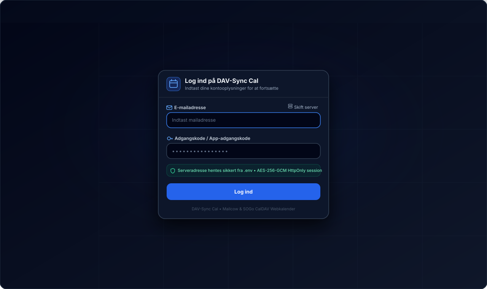

# 📅 DAV-Sync Cal

**En lynhurtig, tastatur-venlig webkalender bygget til personlig planlægning, vagtplanlægning og time-blocking — med direkte Mailcow / SOGo CalDAV-integration, offline PWA-understøttelse og enterprise-grade sikkerhed.**

### Kalenderoversigt (5 visninger, ugenumre, bundplaceret udklipsholder & kompakte farvekasser)


### Login-skærm (Skjult standardserver fra `.env` & valgfri servervælger)


---

## 🎯 Vision & Filosofi

Traditionelle webkalendere kræver ofte utallige museklik og formularer, når man skal planlægge vagter, gentage fokusblokke eller flytte aftaler rundt på tværs af ugen. **DAV-Sync Cal** kombinerer alle klassiske kalenderfunktioner med **ægte "Excel-lignende" Copy/Paste-workflows (`Ctrl+C`, `Ctrl+X`, `Ctrl+V`, `Ctrl+Z`)** direkte i webbrowseren, samtidig med at alt synkroniseres tovejs med din **Mailcow / SOGo**-server.

---

## 🚀 Kernefunktioner

### 📋 1. Ægte Copy / Cut / Paste på tværs af dage (`Ctrl+C`, `Ctrl+X`, `Ctrl+V`)
* **Lynhurtig vagtplanlægning & time-blocking:** Klik på én eller flere aftaler (med `Ctrl`/`Shift`-klik) — eller markér en hel dag — og tryk `Ctrl+C` (kopiér) eller `Ctrl+X` (klip).
* **Visuel Udklipsholder:** Udklipsholderen er placeret praktisk i bunden af sidepanelet, så den aldrig overskygger dine kalendere. Kopi- eller klip-status vises med badges direkte på aftalen i kalendergitteret samt i den flydende handlingslinje.
* **Bevarer klokkeslæt og varighed:** Vælg en hvilken som helst ny dato i kalenderen (fremhæves med en tydelig blå ramme) og tryk `Ctrl+V` — aftalen indsættes med præcis samme start- og sluttidspunkt.

### 📆 2. 5 Fleksible Kalendervisninger & Danske Ugenumre
* **5 visningstilstande:**
  * **År (`multiMonthYear`):** Komplet 12-måneders overblik.
  * **Måned (`dayGridMonth`):** Klassisk månedsoverblik med ren datostruktur.
  * **Uge (`timeGridWeek`):** Tidsblokke for mandag-søndag med præcis timeinddeling.
  * **Dag (`timeGridDay`):** Detaljeret dagsvisning time for time.
  * **Liste (`listMonth`):** Kronologisk dagsorden/liste over alle månedens aktiviteter.
* **Danske ugenumre:** Tydelig visning af ugenumre (`Uge 1`, `Uge 47` osv.) i venstre kolonne på tværs af måned- og ugevisningerne.

### 📐 3. Fleksibel Brugerflade & Kompakte Begivenhedskasser
* **Justerbart & sammenklappeligt sidepanel:** Træk i panelets højre kant for trinløst at justere bredden mellem 180px og 420px, eller skjul panelet helt med knappen i topbaren for maksimal kalenderplads.
* **Kompakte, farvede begivenhedskasser:** Begivenheder vises i kalenderens solide signaturfarve uden unødig hvid luft. Ved mange aftaler på samme dag afskæres listen pænt ved `+ X flere`, uden at datofeltet udvider sig unødigt nedad.

### 🇩🇰 4. Fuld Dansk Sprog- & Tegnunderstøttelse
* **Native Æ, Ø, Å:** Automatisk detektering og håndtering af både UTF-8 og ISO-8859-1 (Latin1/Windows-1252), så danske specialtegn altid vises korrekt i titler, lokationer, beskrivelser og iCal-data.
* **Dansk brugerflade:** Formatering af datoer, klokkeslæt, ugestart (mandag) og tekster følger dansk standard (`da-DK`).

### 💾 5. Import & Eksport (.ics)
* **Import af iCalendar:** Importér nemt `.ics`-filer direkte ind i den ønskede kalender med automatisk tegnkodningshåndtering.
* **Eksport til .ics:** Download enhver kalender som en standard `.ics`-fil til backup eller brug i andre programmer.

### 🖱️ 6. Custom Højrekliksmenu
* Højreklik på en begivenhed eller et datofelt for at åbne den integrerede kontekstmenu.
* Giver lynhurtig adgang til **Kopiér**, **Klip**, **Indsæt**, **Ny begivenhed**, **Redigér**, **Fortryd (`Ctrl+Z`)** og **Flyt til papirkurv (`Delete`)**.

### 🛡️ 7. Mødesikkerhed & Read-Only Beskyttelse
* **Spam-beskyttelse ved møder:** Hvis en begivenhed indeholder inviterede gæster (`ATTENDEE`), spærres `Ctrl+C` automatisk, så du ikke ved en fejl kommer til at duplikere mødeinvitationer til eksterne deltagere.
* **Intelligent Read-Only lås:** Delte kalendere uden skriverettigheder markeres med `🔒 Read-Only` og beskyttes automatisk mod utilsigtede ændringer, sletning og `Ctrl+V`.

### ↶ 8. Lokal Fortryd (`Ctrl+Z`) & 30-dages Papirkurv
* **Fortryd i flere niveauer:** Handlinger lægges i en lokal historik og kan fortrydes med `Ctrl+Z` eller via knappen i topbaren.
* **30-dages lokal papirkurv:** Slettede aftaler gemmes lokalt i 30 dage med dagsnedtælling og kan gendannes med ét klik.

### 🔗 9. Del Kalender med 3. Part (Offentligt Link uden login)
* **Deling via token:** Generér et sikkert delingslink (`?share=<token>`), som giver 3. part direkte adgang til at se kalenderen uden krav om brugernavn eller adgangskode.
* **Valgfri anonymisering:** Vælg mellem fuld visning eller visning af tidsrum som blot *"Optaget"*. Links kan tilbagekaldes når som helst.

### ⚡ 10. Øjeblikkelig Lokal Søgning
* **Hurtig filtrering:** Søgefeltet i topbaren søger øjeblikkeligt i browserens lokale indeks på tværs af titler, lokationer, beskrivelser og deltagere.

### 📶 11. Offline Caching (PWA) & Baggrundssynkronisering
* **IndexedDB & Service Worker:** Alt kalenderdata caches lokalt med **Dexie.js**, så kalenderen kan åbnes og navigeres selv uden internetforbindelse.
* **Sync-kø:** Ændringer foretaget offline lægges i en lokal kø og synkroniseres automatisk mod serveren, når forbindelsen genetableres.

---

## 🔐 Mailcow & SOGo CalDAV Integration

* **Sikker Mailcow Login:** Forbindes direkte til din Mailcow / SOGo CalDAV-tjeneste.
* **Skjult serveradresse:** Serverens URL hentes direkte fra miljøvariablen `DEFAULT_CALDAV_URL`, så brugere blot logger ind med e-mail og adgangskode. Der er mulighed for at folde en "Skift server"-boks ud efter behov.
* **Administration af kalendere:**
  * Opret nye kalendere direkte på serveren (`MKCALENDAR`).
  * Tilføj eksterne eller delte CalDAV-links.
  * Skjul eller gendan kalendere fra oversigten, eller slet egne kalendere permanent.
* **Farvestyring:** Automatisk tovejs-synkronisering af SOGo's kalenderfarver med mulighed for lokal tilpasning.
* **RSVP & Møder:** Se status for deltagere og besvar invitationer (**Deltager**, **Måske**, **Afvis**) direkte i appen.
* **Tidszoner & Notifikationer:** Fuld understøttelse af `VTIMEZONE` og browsernotifikationer via `VALARM`.

---

## 🔒 Sikkerhed & Hærdning (Security)

DAV-Sync Cal er bygget med fokus på enterprise-sikkerhed for at beskytte dine CalDAV-legitimationsoplysninger og data:

* **AES-256-GCM Session Cookies:** CalDAV-adgangskoder gemmes aldrig i klartekst eller i browserens `localStorage`. De krypteres med AES-256-GCM og opbevares i en sikker `HttpOnly`, `SameSite=Lax` session-cookie, som er utilgængelig for ondsindet JavaScript.
* **SSRF- & Origin-validering:** Backend-proxyen er hærdet mod Server-Side Request Forgery. Der tillades udelukkende godkendte HTTP/HTTPS-protokoller, og offentlige delingsendpoints er låst til udelukkende at kontakte den oprindelige ejer-server.
* **Rate Limiting:** Indbygget beskyttelse mod brute-force angreb på login-ruter og CalDAV-kald via `express-rate-limit`.
* **OWASP Headers & CSP:** Streng Content Security Policy (CSP), `X-Content-Type-Options: nosniff`, `X-Frame-Options: DENY`, og `Referrer-Policy: no-referrer`.
* **XSS-beskyttelse:** Alle eksterne links (herunder links til videokonferencer) sanitiseres mod script-injektioner.
* **Container-sikkerhed:** Containeren afvikles under en uprivilegeret bruger (`USER node`) på et minimalt Alpine Linux-image.

---

## ⌨️ Oversigt over Genvejstaster & Musehandlinger

| Handling | Genvej / Mus |
| :--- | :--- |
| **Markér begivenhed** | Venstreklik på begivenhed |
| **Markér flere begivenheder** | `Ctrl + Klik` eller `Shift + Klik` |
| **Vælg mål-dato til indsæt** | Venstreklik på datofelt i kalenderen |
| **Kopiér valgt(e) aftale(r) / dag** | `Ctrl + C` (eller højreklik → *Kopiér*) |
| **Klip valgt(e) aftale(r)** | `Ctrl + X` (eller højreklik → *Klip*) |
| **Indsæt på valgt mål-dato** | `Ctrl + V` (eller klik *Indsæt* i Udklipsholder) |
| **Fortryd seneste handling** | `Ctrl + Z` (eller klik *Fortryd* i topbaren) |
| **Slet til 30-dages papirkurv** | `Delete` / `Backspace` (eller højreklik → *Flyt til papirkurv*) |
| **Åbn / Redigér begivenhed** | Dobbeltklik på begivenhed |
| **Opret ny begivenhed på dato** | Dobbeltklik på et tomt datofelt |
| **Åbn kontekstmenu** | Højreklik på begivenhed eller datofelt |

---

## 🐳 Kørsel i Docker (Multi-Arch: `x86_64` & `ARM64`)

Projektet bygges automatisk via GitHub Actions til både **x86 (`linux/amd64`)** og **ARM (`linux/arm64`)** og udgives på GitHub Container Registry:
**`ghcr.io/mrbridgefarm/webcal:latest`**

### Hurtig start med `compose.yaml` (og `pangolin` netværk)

```bash
# 1. Sørg for at dit "pangolin" Docker-netværk findes:
docker network inspect pangolin >/dev/null 2>&1 || docker network create pangolin

# 2. Hent det seneste multi-arch image og start containeren:
docker compose pull
docker compose up -d
```

I **Pangolin** kan du pege direkte på **`http://dav-sync-cal:3000`** (eller tilgå webkalenderen direkte på `http://<din-vm-ip>:3000`). Se også [`compose.example.yaml`](compose.example.yaml) for et komplet eksempel.

### Miljøvariabler

| Variabel | Standard | Beskrivelse |
| :--- | :--- | :--- |
| `PORT` | `3000` | Porten som webkalenderen og CalDAV-proxyen lytter på |
| `DEFAULT_CALDAV_URL` | *(tom)* | Standard Mailcow / SOGo URL (f.eks. `https://mail.ditdomæne.dk/SOGo/dav/`) |
| `ALLOW_INSECURE_TLS` | `false` | Sæt til `true`, hvis din CalDAV-server anvender et selv-signeret certifikat på lokalt LAN |
| `DATA_DIR` | `/app/data` | Mappen hvor delte kalenderlinks og tokens gemmes persistent |

---

## 🛠️ Teknologisk Stack

* **Frontend:** Vue 3 (Composition API) + TypeScript + Vite + Tailwind CSS + FullCalendar (`dayGrid`, `timeGrid`, `multiMonth`, `list`, `interaction`) + Pinia + Dexie.js (IndexedDB) + VitePWA Service Worker.
* **Backend Proxy:** Node.js + Express + TypeScript + `tsdav` + `ical.js` + direkte WebDAV/CalDAV XML-engine (`PROPFIND`, `REPORT`, `PUT`, `DELETE`, `MKCALENDAR`).
* **Sikkerhed:** `crypto` (AES-256-GCM), `cookie-parser`, `helmet`, `express-rate-limit`, `cors`.
