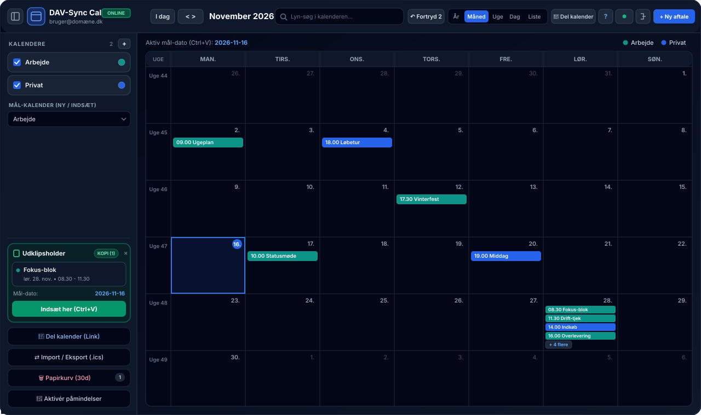

# 📅 DAV-Sync Cal

**En lynhurtig, tastatur-venlig webkalender bygget til personlig planlægning, vagtplanlægning og time-blocking — med direkte Mailcow / SOGo CalDAV-integration.**



---

## 🎯 Vision
Traditionelle webkalendere kræver utallige museklik, når man skal planlægge vagter, gentage fokus-blokke eller flytte aftaler rundt på tværs af ugen. **DAV-Sync Cal** kombinerer alle de klassiske kalenderfunktioner med **ægte "Excel-lignende" Copy/Paste-workflows (`Ctrl+C`, `Ctrl+X`, `Ctrl+V`, `Ctrl+Z`)** direkte i webbrowseren, samtidig med at alt synkroniseres tovejs med din **Mailcow / SOGo**-server.

---

## ✨ Unikke Funktioner ("Drysset")

### 📋 1. Ægte Copy / Cut / Paste på tværs af dage (`Ctrl+C`, `Ctrl+X`, `Ctrl+V`)
* **Lynhurtig vagtplanlægning & time-blocking:** Klik på én eller flere aftaler (med `Ctrl`/`Shift`-klik) — eller markér en hel dag — og tryk `Ctrl+C` (kopiér) eller `Ctrl+X` (klip).
* **Visuel Udklipsholder:** De kopierede aftaler vises øjeblikkeligt i **Udklipsholder-boksen** i venstre sidepanel, som en **svævende handlingsbjælke** nederst på skærmen, og med et `KOPI` / `KLIP`-badge direkte på selve aftalen i kalendergitteret.
* **Bevarer klokkeslæt og varighed:** Klik på en hvilken som helst ny dato i kalenderen (som markeres med en tydelig blå ramme) og tryk `Ctrl+V` — aftalen oprettes på den nye dag med præcis samme start- og sluttidspunkt.

### 🖱️ 2. Custom Højrekliksmenu (som i Google Docs)
* Højreklik på en aftale eller direkte på et datofelt i måned-, uge- eller dagsvisning for at åbne DAV-Sync Cals egen kontekstmenu (`e.preventDefault()`).
* Hurtig adgang til **Kopiér (`Ctrl+C`)**, **Klip (`Ctrl+X`)**, **Indsæt på dato (`Ctrl+V`)**, **Ny begivenhed**, **Redigér**, **Fortryd (`Ctrl+Z`)** og **Flyt til papirkurv (`Delete`)**.

### 🛡️ 3. Mødesikkerhed (Spam-beskyttelse) & Read-Only Beskyttelse
* **Automatisk mødesikkerhed:** Hvis en begivenhed indeholder andre inviterede mødedeltagere (`ATTENDEE`), spærres `Ctrl+C` automatisk med en advarsel, så du aldrig ved et uheld duplikerer mødeindkaldelser og spammer deltagere.
* **Intelligent Read-Only lås:** Delte SOGo-kalendere uden skriverettigheder markeres med et `🔒 Read-Only`-badge og låses automatisk for redigering, Træk-og-Slip, sletning og `Ctrl+V`.

### ↶ 4. Lokal Fortryd (`Ctrl+Z`) & 30-dages Papirkurv
* **Fortryd med ét tryk (`Ctrl+Z`):** Alle oprettelser, redigeringer, træk-og-slip flytninger, indsættelser og sletninger lægges i en lokal historik-stak og kan fortrydes øjeblikkeligt.
* **30-dages lokal papirkurv:** Slettede begivenheder gemmes i browserens IndexedDB i 30 dage med nedtælling og kan gendannes med et enkelt klik.

### 🔗 5. Del Kalender med 3. Part (Offentligt Read-Only Link uden login)
* **Del med ét klik:** Klik på **Del kalender** i topbaren eller ud for en enkelt kalender i sidepanelet for at generere et unikt offentligt delingslink (`https://<din-server>/?share=<token>`).
* **100 % Read-Only uden login:** Når en 3. part åbner dit delingslink, kan de straks se kalenderen (Måned, Uge, Dag og søgning) uden at skulle logge ind — men alt er låst mod ændringer, oprettelser og sletninger.
* **Valgfri anonymisering ("Optaget"):** Vælg om modtageren skal kunne se fulde aftaledetaljer, eller kun tidsrum markeret som *"Optaget"*. Du kan til enhver tid tilbagekalde/slette et delingslink med ét klik.

### ⚡ 6. Øjeblikkelig Lokal Søgning
* **Millisekund-søgning:** Søgefeltet i topbaren filtrerer øjeblikkeligt mod det lokale indeks i browseren på tværs af titler, lokationer, beskrivelser og mødedeltagere.

### 📶 7. Offline Caching (PWA) & Baggrunds-synkronisering
* **100 % Offline læse- og skriveadgang:** Kalenderdata gemmes lokalt i **IndexedDB (`Dexie.js`)** kombineret med en **PWA Service Worker**.
* **Automatisk Sync-kø:** Hvis internetforbindelsen eller Mailcow-serveren er utilgængelig, lægges ændringer i en lokal kø og skubbes automatisk til serveren, så snart forbindelsen er tilbage.

---

## 🔐 Mailcow & SOGo CalDAV Kernemotor

* **Kræver Mailcow Login (forbinder automatisk til `.env`-server):** Appen kræver login med dine Mailcow-oplysninger før kalenderen vises, og henter automatisk standardserveren fra `DEFAULT_CALDAV_URL` i `.env` / `compose.yaml`.
* **Tilføj, Opret, Skjul & Slet Kalendere:**
  * Opret nye kalendere direkte på din Mailcow-server (`MKCALENDAR`) via `+`-knappen i sidepanelet.
  * Tilføj eksisterende eller delte SOGo CalDAV-links direkte.
  * Skjul uønskede kalendere fra oversigten (med mulighed for at gendanne dem) eller slet egne kalendere.
* **Farvestyring:** Synkroniserer automatisk SOGo's serverfarver med mulighed for at overskrive farven lokalt pr. kalender (og gendanne serverfarven med ét klik).
* **RSVP & Mødehåndtering:** Se deltagerstatus og svar **Deltager**, **Måske** eller **Afvis** direkte på mødeinvitationer (`PARTSTAT`).
* **Rige Begivenhedsdata, Tidszoner & Notifikationer:**
  * Klikbare kort-links til lokationer og direkte knapper til videomøder (Google Meet, Teams, Zoom, Jitsi, Whereby).
  * Fuld `VTIMEZONE`-understøttelse via `ical.js`.
  * Indbyggede OS/Browser-notifikationer ved `VALARM`-påmindelser.

---

## ⌨️ Oversigt over Genvejstaster & Musehandlinger

| Handling | Genvej / Mus |
| :--- | :--- |
| **Markér begivenhed** | Venstreklik på begivenhed |
| **Markér flere begivenheder** | `Ctrl + Klik` eller `Shift + Klik` |
| **Vælg mål-dato til indsæt** | Venstreklik på datofelt i kalenderen |
| **Kopiér valgt(e) aftale(r) / dag** | `Ctrl + C` (eller højreklik → *Kopiér*) |
| **Klip valgt(e) aftale(r)** | `Ctrl + X` (eller højreklik → *Klip*) |
| **Indsæt på valgt mål-dato** | `Ctrl + V` (eller klik *Indsæt her* i Udklipsholder) |
| **Fortryd seneste handling** | `Ctrl + Z` (eller klik *Fortryd* i topbaren) |
| **Slet til 30-dages papirkurv** | `Delete` / `Backspace` (eller højreklik → *Flyt til papirkurv*) |
| **Åbn / Redigér begivenhed** | Dobbeltklik på begivenhed |
| **Opret ny begivenhed på dato** | Dobbeltklik på et tomt datofelt |
| **Åbn custom kontekstmenu** | Højreklik på begivenhed eller datofelt |

---

## 🐳 Kørsel i Docker (Multi-Arch: `x86_64` & `ARM64`)

Projektet bygges automatisk via GitHub Actions til både **x86 (`linux/amd64`)** og **ARM (`linux/arm64`)** og udgives på GitHub Container Registry:
**`ghcr.io/mrbridgefarm/webcal:latest`**

### Hurtig start med `compose.yaml` (og `pangolin` netværk)

```bash
# 1. Sørg for at dit "pangolin" Docker-netværk findes:
docker network inspect pangolin >/dev/null 2>&1 || docker network create pangolin

# 2. Hent det færdigbyggede multi-arch image og start containeren:
docker compose pull
docker compose up -d
```

I **Pangolin** kan du pege direkte på **`http://dav-sync-cal:3000`** (eller tilgå webkalenderen på `http://<din-vm-ip>:3000`). Se også [`compose.example.yaml`](compose.example.yaml) for alle konfigurationsmuligheder.

### Miljøvariabler

| Variabel | Standard | Beskrivelse |
| :--- | :--- | :--- |
| `PORT` | `3000` | Porten som webkalenderen og CalDAV-proxyen lytter på |
| `DEFAULT_CALDAV_URL` | *(tom)* | Valgfri standard Mailcow URL (f.eks. `https://mail.ditdomæne.dk/SOGo/dav/`) |
| `ALLOW_INSECURE_TLS` | `false` | Sæt til `true` hvis din Mailcow-server bruger selv-signeret certifikat på LAN |

---

## 🛠️ Teknologisk Stack
* **Frontend:** Vue 3 (Composition API) + TypeScript + Vite + Tailwind CSS + FullCalendar (`dayGrid`, `timeGrid`, `interaction`) + Pinia + Dexie.js (IndexedDB) + PWA Service Worker.
* **Backend Proxy:** Node.js + Express + TypeScript + `tsdav` + `ical.js` + direkte WebDAV/CalDAV XML-engine (`PROPFIND`, `REPORT`, `PUT`, `DELETE`, `MKCALENDAR`).
